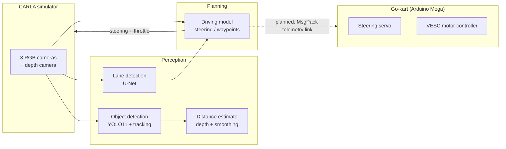

# NeuralDrive

**A self-driving go-kart project: a drive-by-wire electric kart controlled by an Arduino, and a camera-based autonomy stack developed and tested in the CARLA driving simulator.**

https://github.com/user-attachments/assets/d3a31bef-147c-4b3b-8427-c4d78f990779

The goal of NeuralDrive is a go-kart that can steer itself using only cameras. The project has two halves that are being built in parallel:

1. **The kart.** An electric go-kart converted to **drive-by-wire**, meaning the steering wheel and pedal are read as sensors by an Arduino, which then commands a steering servo and the motor controller. Once the computer can control those same outputs, the kart can be driven by software instead of a person.
2. **The autonomy stack.** Lane detection, object detection with distance estimation, and a neural network driving model, all developed in the **CARLA** simulator first, where crashes cost nothing and training data can be generated automatically.

---

## System overview



---

## The kart: drive-by-wire controller

**Files:** `Controller/`

An Arduino Mega sits between the driver and the kart's actuators.

### Steer-by-wire

The steering wheel isn't mechanically connected to the wheels. Instead:

- A **quadrature rotary encoder** on the steering column is read with two hardware interrupts, giving 1,200 counts per revolution, so the Arduino always knows the exact steering wheel angle.
- That angle is converted into a target position for a **270° servo** that drives the steering rack, with configurable ratios for the rack and wheel gearing and hard limits so the servo can't be driven past its range.

Because steering is already electronic, switching from human control to computer control only changes where the target angle comes from.

### Throttle control

The throttle pedal is a potentiometer. Its reading is mapped to a duty cycle and sent to a **VESC** motor controller over UART, with a few safety features built in:

- **Ramp limiting:** the duty cycle can only change by a small step each loop, so the kart accelerates smoothly instead of lurching when the pedal is stomped.
- **Hysteresis:** the motor only turns on once the pedal passes 15% and only turns off below 12%, so pedal noise near zero can't make the motor flicker on and off.
- **Duty cap:** output is capped at 95% duty.

The controller also reads live data back from the VESC (RPM, battery voltage, motor current, duty cycle, and MOSFET and motor temperatures) and prints it for monitoring.

### Telemetry link

**Files:** `Controller/Telemetry.*`, `telemetry/telemery.py`

To connect the computer to the kart, I built a two-way serial protocol on both sides. Messages are encoded with **MsgPack** (a compact binary format) and framed with **COBS** encoding, which guarantees a zero byte only ever appears at the end of a packet, so the receiver can always find packet boundaries even if bytes are lost. Each packet carries an index byte that identifies what kind of message it is, and the Arduino side can send and receive ints, floats, strings, arrays, and key-value maps.

---

## The autonomy stack

### Lane detection

**Files:** `lane_detection/`

A **U-Net** segmentation network, written in PyTorch and trained on the **TuSimple** lane dataset, outputs a pixel mask of where the lane lines are.

- Lane annotations (points along each lane) are converted into training masks by drawing them as thick polylines.
- The model only looks at the bottom half of the frame, where the road is, resized to 256 × 512.
- Training uses a combined **binary cross-entropy + Dice loss**. Lane pixels are a tiny fraction of each image, and the Dice term keeps the network from getting a low loss by simply predicting "no lane" everywhere.
- Random horizontal flips and color jitter make the model more robust to lighting.

### Object detection and distance

**Files:** `object_detection/`

- **YOLO11** detects and tracks cars, pedestrians, and other objects, giving each one a persistent ID across frames.
- For each detection, the distance is read from the **depth camera**. Instead of using the whole bounding box (which includes background around the object), it samples the center half of the box, filters out invalid readings, and takes the 5th percentile, which picks out the nearest surface of the object while ignoring outliers.
- Each tracked object's distance is smoothed over time with an **exponential moving average**, so the reading doesn't jump around frame to frame.

### Driving model

**Files:** `driving_model/`, `sim/drive.py`

This part went through three designs, each one built to address what the previous one couldn't do:

| Version | Approach | What I learned |
|---------|----------|----------------|
| 1. CNN (NVIDIA PilotNet architecture) | Predicts a steering angle from a single camera frame | Trained to a low validation error, but in the simulator it could only drive a few meters before losing control. A single frame doesn't capture how the car is moving. |
| 2. CNN-LSTM | Two CNN branches (camera image and lane mask) feed an **LSTM** over a sequence of 5 frames, so the model sees motion over time | Adding the lane mask as a second input and giving the model memory of recent frames made its steering more informed, but predicting one steering angle still has no notion of where the car is going. |
| 3. Trajectory prediction (Waymo) | A ResNet-18 backbone predicts the car's **next 20 waypoints** instead of a steering angle; steering is then computed by aiming at a waypoint ahead | Planning a path is closer to how real self-driving systems work, and it lets me train on real-world driving data from the Waymo Open Dataset instead of only simulator data. |

### Training data

**Simulator data** (`data_logger/`, `sim/`): A data logger records synchronized frames from three forward cameras (left, center, right) along with the lane mask and steering angle, toggled with a key press while driving in CARLA. A few tricks improve the dataset:

- **Side cameras as extra training examples:** left and right camera images are labeled with the center steering angle plus or minus a correction, which teaches the model how to steer back toward the center of the lane.
- **Steering noise injection:** random steering disturbances are added while recording, so the dataset includes examples of the car drifting off course and recovering.
- **Histogram balancing:** most driving is straight ahead, so over-represented steering angles are trimmed until the distribution is even. Otherwise the model learns to always drive straight.

**Real-world data** (`driving_model/waymo/`): The Waymo End-to-End Driving dataset ships as TFRecord files, which normally require TensorFlow to read. I wrote `data_set_converter.py`, which parses the TFRecord format directly in pure Python and converts each frame (three camera images, future waypoints, vehicle pose, and camera calibration) into a single **HDF5** file that PyTorch can load quickly without TensorFlow. This also lets frames be streamed from disk instead of loading the whole dataset into memory.

---

## Repository layout

```
NeuralDrive/
├── main.py                     # Starts the CARLA simulation
├── sim/
│   ├── world.py                # Loads the map, spawns the car and cameras, main loop
│   ├── observer.py             # Camera and depth sensor callbacks
│   ├── detector.py             # Runs lane + object detection on each frame
│   ├── drive.py                # Turns model output into vehicle controls
│   ├── controller.py           # Manual keyboard driving
│   └── npc_manager.py          # Spawns traffic and pedestrians
├── lane_detection/             # U-Net model, TuSimple dataset, training
├── object_detection/           # YOLO wrapper, depth-based distance, smoothing
├── driving_model/
│   ├── nvidia_model/           # Version 1: PilotNet CNN (Keras)
│   ├── CNNLSTM/                # Version 2: CNN-LSTM (PyTorch)
│   ├── waymo/                  # Version 3: Waymo dataset converter and trajectory model
│   └── steering_model.py       # Waypoints-to-steering wrapper used by the sim
├── data_logger/                # Records simulator training data
├── telemetry/                  # Python side of the MsgPack/COBS serial link
└── Controller/                 # Arduino Mega drive-by-wire firmware
```

---

## Getting started

### Simulator

1. Install and launch [CARLA](https://carla.org/) so the server is running on `localhost:2000`.
2. Clone the repo. Model weights are stored with Git LFS, so install it first:
   ```bash
   git lfs install
   git clone https://github.com/Akshajk3/NeuralDrive.git
   cd NeuralDrive
   ```
3. Install the Python dependencies:
   ```bash
   pip install carla torch torchvision ultralytics opencv-python pygame numpy pandas \
       albumentations h5py kagglehub msgpack cobs pyserial scikit-learn
   ```
4. Run the simulation:
   ```bash
   python main.py
   ```

| Key | Action |
|-----|--------|
| W / S | Throttle / brake |
| A / D | Steer left / right |
| R | Start or stop recording training data |

### Kart controller

Open `Controller/Controller.ino` in the Arduino IDE, install the **VescUart** and **MsgPacketizer** libraries, and upload it to an Arduino Mega.

---

## Project status

| Part | Status |
|------|--------|
| Drive-by-wire steering and throttle firmware | Working |
| Serial telemetry protocol (Arduino and Python) | Implemented |
| Lane detection | Trained and running in CARLA |
| Object detection with distance | Running in CARLA with traffic and pedestrians |
| Driving model | Version 3 (Waymo trajectory model) in training and evaluation |
| Running the autonomy stack on the real kart | Not started |

## Roadmap

- [ ] Get the trajectory model driving reliably in CARLA
- [ ] Use object distances to slow down and stop for obstacles
- [ ] Mount cameras and an onboard computer on the kart
- [ ] Send steering and throttle commands from the computer to the Arduino over the telemetry link
- [ ] Add a hardware emergency stop and a manual override before any autonomous testing

---

## Built with

Python · PyTorch · Keras · Ultralytics YOLO11 · OpenCV · CARLA · HDF5 · Arduino (C++) · VESC · MsgPack

## Acknowledgments

- [CARLA](https://carla.org/), the open-source driving simulator used for development and data collection
- The [TuSimple](https://github.com/TuSimple/tusimple-benchmark) lane detection dataset
- [Ultralytics YOLO11](https://docs.ultralytics.com/) for object detection and tracking
- The [Waymo Open Dataset](https://waymo.com/open/) End-to-End Driving dataset and Waymo's vision-based end-to-end driving tutorial notebook (included in `driving_model/waymo/`)
- *End to End Learning for Self-Driving Cars* (Bojarski et al., NVIDIA, 2016), the source of the PilotNet architecture
- U-Net architecture from *U-Net: Convolutional Networks for Biomedical Image Segmentation* (Ronneberger et al., 2015)
